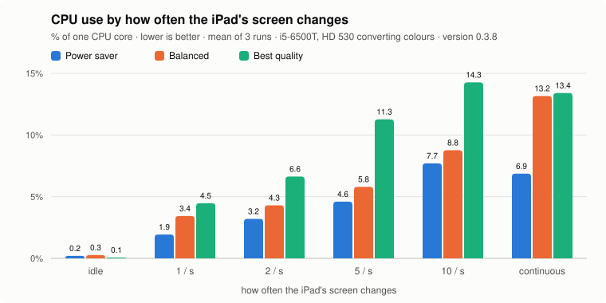

# OpenDisplay for X11

*An unofficial sender for the [OpenDisplay](https://github.com/peetzweg/opendisplay) iPad app — not affiliated with the OpenDisplay project.*

Use an iPad as a wired, extended second monitor for a Linux X11 desktop —
plug in the cable, open the app, and the desktop extends onto it. Touch,
drag, long-press right-click and two-finger scroll work on the iPad.

> [!IMPORTANT]
> **Your computer needs a free video port.** odx11 turns an *empty* video
> output socket into the iPad's monitor: an **HDMI socket**, or a
> **DisplayPort socket that accepts HDMI adapters** (most Intel desktops and
> many laptops have one). On Linux X11 an app cannot create a monitor out of
> nothing — the graphics driver only offers monitors for sockets that exist.
> **It will not work** if every video port already has a monitor, if the only
> free port is USB-C/Thunderbolt (untested, most likely not), or with NVIDIA's
> proprietary driver. → [Why a free video port is required](#why-a-free-video-port-is-required)

It is an X11 *sender* for the [OpenDisplay](https://github.com/peetzweg/opendisplay)
protocol; the iPad runs the unmodified OpenDisplay app as the *receiver*.
Everything runs over the USB cable through the stock `usbmuxd` — no Wi-Fi,
no USB networking, no browser, no custom kernel.

Developed and verified on an HP EliteDesk 800 G3 DM (Intel HD 530) with
Linux Mint 22.3 Cinnamon and an iPad Air (5th gen). Design, decisions and
acceptance criteria: [`PROJECT_SPEC.md`](PROJECT_SPEC.md).

## How it works

```
iPad (OpenDisplay app, listens on :9000)
   ▲ USB cable — usbmuxd byte pipe: [len][H.264 frame] →   ← [len][JSON: hello/touch/scroll/ping]
   │
odx11 daemon (systemd --user)
   ├─ forces a spare HDMI connector "connected" (no root: udev rule) → X sees a new monitor
   ├─ captures that monitor's area (ximagesrc) → H.264 on the GPU (VA-API)
   ├─ touch/scroll → XTest pointer events on that monitor
   └─ pauses capture while nothing on the iPad's monitor changes
```

- **Virtual monitor:** the GPU's spare DP++ port is exposed as an HDMI
  connector; forcing it on makes X create a real monitor with nothing
  plugged in. Your desktop treats it like any other screen.
- **Size:** the monitor is the iPad's panel divided by `divisor` (1.5), so
  text stays readable; the iPad scales it up. 2360×1640 → 1568×1088.
- **Lifecycle:** usbmuxd reports the iPad plugged in → the daemon dials the
  app → on `hello` the monitor appears and streams. Unplugging removes it at
  once; an app switch or a lock shorter than 10 s keeps it, so windows don't
  reshuffle.
- **Cursor:** the iPad draws the cursor itself from small position messages (up
  to 120 a second), so it follows your hand without waiting for video frames.
- **Only changes cost CPU:** frames are converted and encoded only for a moment
  after something on the iPad's monitor changes, so a clock or system monitor
  ticking there costs little.
- **Idle:** capture pauses after 1 s with nothing changing on the iPad's
  monitor (per-window X damage, pointer motion, touch) — about 1 % of one CPU
  core idle vs ~20 % while streaming.

## Requirements

| | Needed | Notes |
|---|---|---|
| Session | X11 | Wayland is not supported (use [opendisplay-linux](https://github.com/tixwho/opendisplay-linux) there). Any X11 desktop or window manager. |
| **Free video port** | An **empty** HDMI socket, or a DisplayPort socket that accepts HDMI adapters (DP++) | **Hard requirement** — see [below](#why-a-free-video-port-is-required). Nothing may be plugged into it. |
| GPU | Kernel DRM driver | Tested on Intel `i915`. `amdgpu` should work for the monitor; encoder settings untested. NVIDIA's proprietary driver cannot do this. |
| Encoder | VA-API H.264 via `gstreamer1.0-vaapi` | Intel: `intel-media-va-driver` (the free build is enough). |
| OS | systemd user session, Python ≥ 3.11, Debian/Ubuntu packages | Mint 22.3 / Ubuntu 24.04 tested. The installer uses `apt`. |
| iPad | iPadOS 15+ (upstream; the Linux fork states 16+), OpenDisplay app, a USB **data** cable | The app is a [TestFlight beta](https://testflight.apple.com/join/3NYaY11c). The iPad must be trusted (paired) and unlocked. |

## Why a free video port is required

**In short:** on X11, monitors come from the graphics hardware, not from apps.
odx11 needs an unused video socket to pretend a monitor is plugged into it.

**How X11 decides which monitors exist.** The X server (the part of Linux that
draws your desktop) asks the graphics driver what video outputs it has, and the
driver answers with one entry per physical socket on the GPU. Every screen in
your Display settings is one of those sockets with a monitor attached. The chain
is fixed: *socket on the GPU → kernel connector → X output → a screen your
desktop can put windows on.* An application cannot add a socket the kernel does
not know about, so it cannot add a monitor.

**What odx11 does.** It takes a socket that exists but is empty and tells the
kernel "act as if a monitor were plugged in here". X then sees a new screen,
your desktop extends onto it, and odx11 captures that screen and sends it to
the iPad. The GPU is driving a monitor that isn't really there. With no empty
socket, there is nothing to pretend with.

**Why Windows and macOS don't need this.** Windows has an official feature for
software-only monitors (the *Indirect Display Driver* framework — spacedesk
uses it); macOS has a virtual-display API (OpenDisplay's own Mac app uses it);
Wayland desktops (KDE, GNOME, Hyprland) draw their screens themselves and can
add a virtual one. X11 has no such feature: with the standard `modesetting`
driver that modern distributions use, outputs come only from the kernel.

**Will it work on my computer?**

| Computer | Works? |
|---|---|
| Free HDMI socket (desktop or laptop) | Yes |
| Free DisplayPort socket on an Intel desktop (usually DP++, i.e. takes a passive DP→HDMI adapter) | Yes — this is how it was developed: the free DisplayPort socket appears to Linux as both `DP-1` and `HDMI-A-1` |
| Only free port is USB-C / Thunderbolt | Untested — most likely not (those ports are DisplayPort-only) |
| AMD graphics with only DisplayPort sockets free | Untested |
| Every video port already has a monitor | No |
| NVIDIA proprietary driver | No |

To check without opening a terminal: look at the back or sides of the
computer for an empty HDMI or DisplayPort socket. For the technically
inclined, `ls /sys/class/drm` lists the GPU's sockets (`card1-HDMI-A-1`, …)
and `cat /sys/class/drm/card*-HDMI-A-*/status` shows which are free
(`disconnected`).

**If you have no free port.** The only dependable option today is a
*dummy plug* (an HDMI or DisplayPort "headless" adapter, a few dollars) in a
free socket — but then that monitor exists all the time, even without the
iPad. Other routes exist and were rejected for now: an extra kernel module that
adds virtual sockets (EVDI, from DisplayLink — rebuilt on every kernel update,
needs signing under Secure Boot, breaks after updates), the kernel's virtual GPU
(`vkms`, not usable with an existing X desktop), the old Intel X driver's
virtual outputs (replaces your display driver with a deprecated one), and a
software-only "invisible screen area" trick (unproven: X keeps the mouse
pointer out of areas no real output shows).

## Install

1. Download `opendisplay-x11_<version>_all.deb`.
   **First make sure your computer has a free video port** ([above](#why-a-free-video-port-is-required)).
2. Double-click it. Your distribution's package installer opens; click
   **Install** and enter your password. Everything it needs comes with it.
3. Log out and back in once (or, until the settings app exists, restart).

That's all — from then on odx11 starts with your desktop. First time with the
iPad: plug it in, unlock it and tap **Trust** when it asks.

What the package installs (nothing runs as root):

| What | Where | Why |
|---|---|---|
| The program | `/usr/lib/python3/dist-packages/odx11/`, `/usr/bin/odx11` | |
| udev rule | `/usr/lib/udev/rules.d/70-opendisplay-x11.rules` | Lets members of `plugdev` force a spare HDMI port on/off — the only privilege odx11 needs. The account created when the system was installed is in `plugdev` on Mint, Ubuntu and Debian; accounts added later are not (the setup checklist explains the fix). |
| User service | `/usr/lib/systemd/user/odx11.service` | The daemon; unforces the port on every exit, even a crash |
| Autostart entry | `/etc/xdg/autostart/opendisplay-x11.desktop` | Starts the service when your desktop session starts (XDG autostart — GNOME, KDE, XFCE, MATE, Cinnamon, LXQt) |

Updates install like any other package. The running service notices the new
version and restarts itself onto it — the iPad blinks for a few seconds, and
nothing else is needed (no log-out).

Switch it off without uninstalling: the switch in the window, or Start at login.

## Use

Plug in the iPad, unlock it, open OpenDisplay. That's it.

To see what it's doing or change anything, open **OpenDisplay for X11** from the
application menu: its status (and what to do, if anything), an on/off switch,
the settings (they apply as you change them), a setup checklist with a QR code
for the iPad app, and a diagnostic report for bug reports. It also tells you
through a desktop notification when you need to do something (for example, open
the app on the iPad) — and otherwise stays silent.

| On the iPad | Does |
|---|---|
| Tap | Left click (on lift) |
| Long-press (½ s), lift | Right click |
| Drag | Drag (starts after ~8 px of movement) |
| Two-finger scroll | Scroll wheel, natural direction |
| Rotate | The monitor rotates (portrait = same mode, rotated) |

Arrange the iPad monitor in your desktop's display settings. Cinnamon
remembers the arrangement across reconnects and reboots (verified); other
desktops that save monitor layouts should too (untested). Where nothing
remembers layouts, `[devices]` `side`/`align` in the config place it.

```bash
journalctl --user -u odx11 -f                 # what the daemon is doing
systemctl --user restart odx11                # after changing the config
python3 -m odx11 list                         # iPads usbmuxd sees
systemctl --user stop odx11 && python3 -m odx11 run -v   # foreground, verbose (debugging)
```

## Performance

Measured on 2026-10-15 (version 0.3.4) — HP EliteDesk 800 G3 DM: Intel Core
i5-6500T (4 cores), HD 530 graphics, Linux Mint 22.3 Cinnamon (X11), iPad Air
(5th gen) over USB, virtual monitor 1568 × 1088, Balanced preset (60 fps).
Each row is the mean of 3 runs of 25 s after an 8 s warm-up (spread in brackets).

**How often the iPad's screen changes decides the cost**, not which app changes
it: each change converts and encodes whole frames. "Changes per second" uses a
test window redrawing at a fixed rate, so you can place any app on the curve —
a clock ≈ 1/s, a system monitor ≈ 2/s, typing ≈ 5–10/s in bursts, scrolling or a
video ≈ continuous.

| iPad screen changes | CPU, % of one core | Frames/s sent | Latency median / 95th % | Memory (PSS) |
|---|---|---|---|---|
| never (idle) | **0.1** (0.1–0.1) | 0 | — | 52 MB |
| 1 × per second | **6.0** (5.6–6.3) | 3.7 | 10.7 / 17.4 ms | 57 MB |
| 2 × per second | **8.6** (8.4–8.8) | 7.4 | 10.5 / 17.2 ms | 59 MB |
| 5 × per second | **13.9** (13.9–13.9) | 14.3 | 13.7 / 17.9 ms | 59 MB |
| 10 × per second | **25.1** (25.0–25.2) | 29.1 | 12.3 / 16.9 ms | 57 MB |
| continuously (video, scrolling) | **45.9** (45.8–46.0) | 59.6 | 10.7 / 15.8 ms | 59 MB |
| continuously, Power saver (30 fps)¹ | **22.9** (22.8–23.0) | 29.5 | 10.1 / 13.6 ms | 56 MB |

¹ measured with 0.3.3; continuous change is unaffected by the 0.3.4 change.

<picture>
  <source media="(prefers-color-scheme: dark)" srcset="docs/perf/cpu-by-change-rate-dark.svg">
  
</picture>

*0.3.3 sent 150 ms of frames after every change; 0.3.4 sends 50 ms plus one settle
frame. The chart is generated from the CSVs by `tools/perf_chart.py`. Encode time
on the iPad ~8–9 ms throughout.*

- **CPU** is for the OpenDisplay for X11 service as a percentage of *one* core; a
  system monitor showing the whole 4-core processor shows a quarter of it
  (worst case ≈ 12 %).
- **Memory** is the service's own share (PSS) and stays flat under load; a
  system monitor's "resident" figure (~92 MB) also counts shared libraries.
- **Latency** is end to end, capture to the iPad's screen, and with the **encode
  time** is reported by the iPad itself. At 60 fps a frame starts every 16.7 ms.
- **Where the CPU goes** at 60 fps: screen capture ~1.5 %, colour conversion ~32 %
  (software: this GPU's free driver has no video-processing unit), handing
  frames to the hardware encoder ~13 %, the program's own code ~1–2 %. After a
  change, frames are sent for 50 ms (`change_tail_ms`) and one more once the
  screen has been quiet for 300 ms (`change_settle_ms`, it catches the end of
  fades and late repaints) — about 3–4 frames per change.
- The cursor is drawn by the iPad from position messages: moving the mouse costs
  almost nothing and never depends on the frame rate.

Reproduce (iPad attached, OpenDisplay open, nothing else changing on its screen;
the user service is stopped during the runs and restarted after):

```bash
python3 tools/perf_bench.py --scenario rate --hz 5 --runs 3 --csv docs/perf/results.csv
```

Scenarios: `idle`, `rate --hz N` (a test window, `tools/test_window.py`),
`continuous`, `continuous30`, `light` (whatever is on the iPad's screen). Raw data:
[`docs/perf/results.csv`](docs/perf/results.csv) (0.3.4), [`results-0.3.3.csv`](docs/perf/results-0.3.3.csv).

## Configure

Optional: `cp config.example.toml ~/.config/odx11/config.toml`. Every setting
is documented there with its default; unknown keys are rejected so typos fail
loudly. The ones people change:

| Setting | Default | Effect |
|---|---|---|
| `[video] preset` | `balanced` | Performance: `power_saver` (30 fps, least CPU), `balanced` (60 fps), `best_quality` (60 fps, sharpest), or `custom` to use the three below |
| `[display] divisor` | `1.5` | Bigger = larger text, fewer pixels on the iPad |
| `[video] qp` | `26` | Picture quality: lower = sharper, more bandwidth (0–51) |
| `[video] fps` | `60` | Frame rate while streaming (with `preset = "custom"`) |
| `[video] idle_pause_s` | `1.0` | Pause capture after this long with no change; `0` = always stream |
| `[input] long_press_ms` | `500` | Hold time for right-click |
| `[session] grace_s` | `10` | How long a dropped connection keeps the monitor |

## Limitations

**By design**
- **X11 only.** No Wayland.
- **USB only.** The Wi-Fi transport is not implemented (planned, M6).
- **One iPad at a time.** A second one is used when the first is unplugged.
- **Streaming at 60 frames per second costs about half of one CPU core** while
  the iPad's screen changes (colour conversion runs in software on this kind of
  GPU); nothing while it is still. 30 fps in the settings halves that.
- **No Apple Pencil pressure/tilt.** The Pencil works as a finger (M5).
- **No audio, clipboard or mirror mode.**

**Hardware and platform**
- **Needs a spare, empty HDMI/DP++ port** on a DRM GPU (Intel/AMD). Without
  one there is no virtual monitor. A DP dummy plug is the fallback but then
  the monitor exists even without the iPad.
- **Encoding is tuned for Intel VA-API** (`vaapih264enc` in low-power CQP
  mode). On the HD 530 there is no bitrate control (needs HuC firmware), so
  bandwidth varies with content — irrelevant over USB. `gstreamer-vaapi` is
  deprecated upstream; a future GStreamer may need a different encoder.
- **Secure Boot:** kernel lockdown blocks the runtime EDID, so the monitor is
  listed as `unknown` in display settings. Everything else works. A boot-time
  EDID is possible (`edid/make_edid.py`, `drm.edid_firmware=`), not set up.
- **All iPads share one monitor identity,** so two different iPads cannot have
  different remembered placements.
- **Picture is scaled.** The desktop is smaller than the panel (÷ 1.5) and
  the iPad upscales it, so it is slightly soft. Lower `divisor` for sharper
  but smaller text.

**Behaviour**
- **Idle detection doesn't see what the compositor draws itself** (panels,
  OSDs, notifications). If you move a panel onto the iPad monitor, its changes
  won't wake a paused stream until something else does.
- **Locking the iPad longer than 10 s** removes the monitor; it comes back on
  unlock (with the app in front).
- **Disabling the monitor in display settings** pauses odx11 until the iPad
  is unplugged and replugged — otherwise it would immediately come back.
- **Startup takes ~1 s** after the app connects (connector hotplug).
- **The receiver app is a TestFlight beta.** If the beta closes before an App
  Store release, there is no receiver.

## Security

- The daemon **listens on nothing** — no port, no D-Bus. It only dials out to
  the iPad through usbmuxd and reads touches from that one connection.
- **Nothing runs as root.** The only privilege is a udev rule that lets the
  `plugdev` group (the account made when the system was installed) force HDMI ports on/off — the same thing any
  of your programs can already do to monitors with `xrandr`. DP ports are
  never covered.
- **The OpenDisplay app has no authentication** (protocol v3). Anyone on the
  iPad's Wi-Fi, and any local user via the world-writable usbmuxd socket, can
  connect to it and *replace* the picture or receive your touches. They cannot
  see your desktop or click on your PC. If that matters, turn off the iPad's
  Wi-Fi while using it.
- Touch is clamped to the virtual monitor; the iPad cannot click on your
  main screen.

## Troubleshooting

| Symptom | Check |
|---|---|
| Nothing happens when the app opens | `journalctl --user -u odx11 -f`. "dial refused" = the app is not in front or the iPad is locked. |
| `no USB iOS device` / not paired | Unlock, tap Trust, `idevicepair pair`, `idevicepair validate`. Charge-only cables don't work. |
| "Setup is not finished: this account may not switch HDMI-A-n" | Your user must be in `plugdev` (Users and Groups settings); log out and back in. |
| "HDMI-A-n has a real monitor plugged in" / "no HDMI-A-n port" | Set `[display] connector` to a free HDMI port (`ls /sys/class/drm`). |
| Monitor appears but iPad stays black | Make sure the app is in front; check `journalctl` for pipeline errors; `gst-inspect-1.0 vaapih264enc` must succeed. |
| Text too small / too big | `[display] divisor` (lower = smaller text, sharper). |
| Service not started after login (bare WM) | Your window manager must run XDG autostart entries (e.g. with `dex -a`). |
| A stuck invisible monitor after a crash | `odx11 release` (no sudo; the service does this on every exit). |

## Uninstall

Remove **opendisplay-x11** in your software manager (or `sudo apt remove
opendisplay-x11`). Running sessions are stopped and the port released. Your
`~/.config/odx11/config.toml` and the desktop's saved monitor layout are left in place.

## Contributing

Contributions are welcome — see [`CONTRIBUTING.md`](CONTRIBUTING.md). Every commit
needs a `Signed-off-by` line (`git commit -s`).

## License

OpenDisplay for X11 is free software: GPL-3.0-or-later (see [`LICENSE`](LICENSE)).
© 2026 Vibhanshu Biswas and contributors. You may use, change and share it; if you share a
changed version, it must stay under the same licence with its source available.
OpenDisplay (the iPad app) is a separate project by its own authors.

## Development

```bash
bash install.sh --check                               # can this machine build and run it?
bash install.sh                                       # build dist/*.deb from the checkout and install it
python3 -m venv --system-site-packages .venv && .venv/bin/pip install pytest
.venv/bin/python -m pytest -q tests/                 # no iPad, X server or GPU needed
python3 tools/fake_receiver.py --port 9000            # strict stand-in for the iPad...
python3 -m odx11 run --tcp 127.0.0.1:9000             # ...that the daemon dials directly
bash tools/idle_cpu.sh 10                             # AC 23: idle CPU of the running service
d2 docs/architecture.d2 docs/architecture.svg         # render the diagram on demand (not committed)
```

Layout and invariants for contributors: [`CLAUDE.md`](CLAUDE.md). The
protocol this implements: upstream
[`PROTOCOL.md`](https://github.com/peetzweg/opendisplay/blob/main/PROTOCOL.md).
